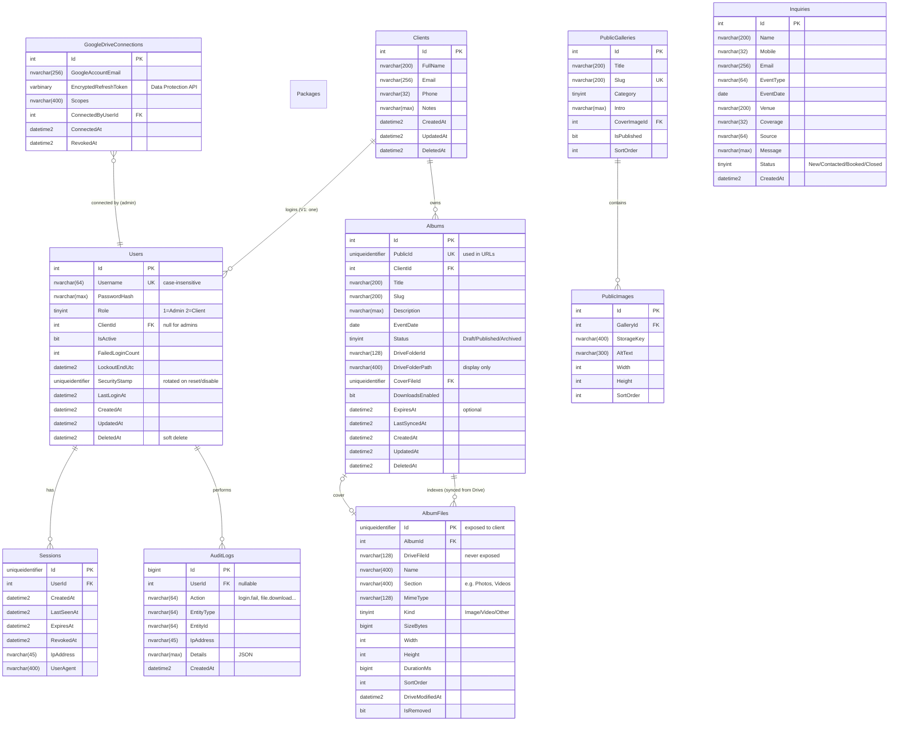

# Frans Studios — Audit & Architecture

Status: **Approved 2026-10-04 · V1 implemented** (see "Approved decisions" and "Implementation notes" below)
Stack (fixed): React + Vite + JavaScript/JSX + React Router · ASP.NET Core Web API (C#, .NET 10 LTS) · SQL Server + EF Core · Google Drive API

---

## Approved decisions (V1)

| Topic | Decision |
|---|---|
| Hosting | Windows + IIS (in-process ASP.NET Core), SQL Server. Nothing IIS-specific in code; see `docs/DEPLOYMENT.md` §13 for moving later. |
| Packages | Inquiry form only. A `Packages` table + admin screen exist; tiers appear on the page only once the studio publishes one. No invented names/prices. |
| Logins | One login per client in V1; a client sees all of their published albums. Schema already supports several logins per client (`Users.ClientId`, many→one). |
| Google account | Personal Gmail now. Same code works for Google Workspace (Internal consent screen) and shared drives (`supportsAllDrives`). |
| Album expiry | None. Admin can set an album to **Disabled** at any time. |
| Language | English. Customer-facing strings live in `Frontend/src/i18n/en.js`; CSS uses logical properties; `<html dir>` is set from the locale, so Arabic/RTL is an addition, not a rebuild. |
| Email | Non-blocking and configurable (`Email:Provider` = `None` \| `Smtp`); `IEmailSender` allows other providers. |
| Delivery | Streaming proxy with HTTP Range; Drive files never public; Google tokens never in React; `AlbumFiles` index with our own IDs; 404 for anything not owned. |
| Web | Same-origin (ASP.NET Core serves the React build and `/api`); server-side SEO tags; 301s from WordPress URLs. |

### Public media vs private client media — two separate systems

| | **Public portfolio media** | **Private client deliveries** |
|---|---|---|
| What | Portfolio photos, film posters, web-encoded films | Original photos, master + web videos, documents |
| Source of truth | Uploaded in *Admin → Portfolio / Films* | The client's Google Drive folder |
| Stored | Server disk `Storage:PublicMediaPath` (as WebP + JPEG variants, EXIF/GPS stripped) | Google Drive only (SQL keeps an index: `AlbumFiles`) |
| Served at | `/media/…` — static, `Cache-Control: public, immutable` | `/api/client/files/{id}/…` — authenticated, ownership-checked, streamed |
| Code | `Storage/PublicMediaStore.cs`, `Features/Public`, `AdminGalleries/Films` | `GoogleDrive/*`, `Features/ClientPortal` |
| Caching | Browser/CDN cache forever (keys are unique per upload) | `private` only; thumbnails cached on disk in `Storage:PrivateCachePath` (not web-served) |

The two never share a folder, a URL prefix, an entity or a service.

### Implementation notes (changes vs. the proposal below)

- **Users ↔ Clients:** `Users.ClientId` (nullable FK, check constraint: admins have none, client logins must have one) replaces `Clients.UserId`, so multiple logins per client can be added without a migration of existing data.
- **AVIF:** ImageSharp has no AVIF encoder, so public images are generated as **WebP + JPEG** (WebP is supported by every current browser). AVIF could be added later with libvips if needed.
- **ImageSharp 3.1.x** (not 4.x): v4 requires a license key at build time; 3.1 is free under the Six Labors Split License for businesses under US$1M revenue.
- **Google SDK not used:** the Drive v3 REST API is called directly with `HttpClient` (five endpoints). This keeps Range headers byte-exact for streaming and adds no dependencies.
- **Antiforgery:** enforced by a small middleware for all unsafe `/api` requests (header `X-XSRF-TOKEN`), plus `SameSite=Strict` cookies.
- **ZIP downloads** are per section (e.g. "Photos"), capped by `GoogleDrive:MaxSectionZipGb` (default 10 GB); larger sections download per file.

---

## A. Website Audit (fransstudios.com, inspected 2026-10-04)

### A.1 What the site actually is

| Item | Finding (verified) |
|---|---|
| Platform | WordPress 7.1.2 + Elementor 4.2.1, LiteSpeed, PHP 8.2, Jetpack image CDN (`i0.wp.com`), Google Site Kit |
| Pages in nav | Home · About us · Cinematography · Portfolio (`/portofolio/`) · Packages (`/packages-2/`) · Contact us |
| Album pages | 6 linked from home: Europe portfolio 🇦🇹, Patti & Franc, Mariam & Mina, Adelina & Abdulla, Sara & Amr, Maria & Mina. Each is a flat grid of numbered images (e.g. Sara & Amr = 72 images) with a lightbox |
| Portfolio | One long unfiltered grid of ~211 images, no categories or album titles |
| Cinematography | 4 films (Mahi & Omar, Mariam & Mina, Catherina & Alex, Hanaa & Amr), **self-hosted MP4s**: 112 MB and 69 MB files served directly from WordPress uploads |
| Packages | **No packages or prices are listed.** The page is an inquiry form (name, event type, date, venue, mobile, coverage half/full day, referral source, message) |
| Contact | Email `Frans.Weddings@gmail.com`, phone/WhatsApp `+20 128 666 0303`, Instagram, a second, shorter contact form, and a FAQ (two photographers per package, 50% non-refundable deposit) |
| About | Founder story (Joe Frans), team of 7 named members, 4 client testimonials |
| Home | Tagline "LOVE. ART. CAPTURED", stats (1M+ shots, 1000+ weddings, 60K followers, 14+ years), founder intro, portfolio teaser, film teaser, CTA tiles (Packages / About / Contact) |
| Client area | **None exists today.** No login and no private galleries. The client portal is net-new |

### A.2 Design system (as built)

- **Type:** Cormorant Garamond (display serif) + DM Sans (body). The page also loads Forum, Roboto, Roboto Slab, Neuton, Cormorant, Cormorant Infant and Lora: **9 font families, 11 font stylesheets**, most of them unused leftovers from Elementor.
- **Colour:** white background with a muted olive/sage text colour (`rgba(83,105,65,.8)`). Warm, natural and film-like. This palette is the brand's strongest asset.
- **Voice:** romantic, documentary, "film tones and black & white". The new site should feel calm and editorial, not flashy.

### A.3 Problems found

**Performance**
- Homepage: **168 requests, ~4.7 MB transferred, DOMContentLoaded ≈ 5.6 s**, 56 script files (GTM, Jetpack stats, jsDelivr, Cloudflare Turnstile, Elementor), 31 stylesheets, 255 KB of HTML.
- **0 of 69 images use `loading="lazy"`**. Gallery images have no `srcset`, and album pages load 2560 px originals.
- HTML is sent with `Cache-Control: no-store` and sets a `PHPSESSID` cookie on a public page, so it can't be cached at the edge.
- Films are 70–110 MB progressive MP4s with no poster optimisation or adaptive quality.

**SEO**
- **No meta description and no Open Graph tags** on the homepage. Sharing a link on WhatsApp or Instagram gives a bare preview. That matters for a business that gets bookings through WhatsApp.
- **No `<h1>` on the homepage.** The stats ("1M+") are `<h3>` and the couple names are `<h2>`.
- No structured data (no `LocalBusiness` / `ProfessionalService` / `ImageGallery` JSON-LD).
- Alt text is numeric (`alt="13"`) or empty. The images carry no information for search or for screen readers.
- Slugs are messy: `/portofolio/` (typo), `/packages-2/`, and an emoji slug for the Europe album.
- `wp-sitemap-users-1.xml` publishes WordPress usernames (a minor security leak), and the sitemap includes unused post types (`events`, `csm_country`).
- Broken link: `/?page_id=3344` in the homepage returns **404**.
- The page titles are generic ("FRANS STUDIOS") and don't mention the city, the country or "wedding photographer".

**UX / accessibility**
- Packages is labelled as offers but contains none, which breaks what the visitor expects.
- There are two different inquiry forms with different fields.
- The portfolio is an unstructured wall of 211 images with no story grouping.
- Body text is olive at 80% opacity on white, which needs a contrast check (likely borderline for small text).
- The "1M+ / 1000+" stats are presented as headings, which pollutes the outline for screen readers.

### A.4 Keep / Improve / Redesign / Remove / Add

| Action | Items |
|---|---|
| **Recreate closely** | Brand name and logo, the serif + sans pairing (reduced to 2 families), the olive/warm-neutral palette, founder voice and copy, testimonials, team, FAQ, the contact details (email, phone, WhatsApp, Instagram) |
| **Improve** | Album pages (story-led layout with a cover, intro, editorial grid, lightbox, prev/next album), the films page (posters, lazy players, compressed web encodes), titles and meta, alt text, headings, image pipeline (AVIF/WebP + `srcset`), contrast |
| **Redesign** | Portfolio: grouped by story/album with a filter (Weddings / Engagements / Destination), instead of 211 loose images. Packages: either real tiers or an honest "Request our packages" page (owner decides; see Open questions). Merge the two forms into one inquiry flow |
| **Remove** | Unused fonts, Elementor/Jetpack/GTM bloat (keep a single analytics tag only if the owner uses it), the emoji slug, the `-2` and `portofolio` slugs (301-redirect them), the broken `page_id` link, the user sitemap |
| **Add** | Private client galleries (Drive-backed), admin dashboard, `LocalBusiness` + `ImageGallery` JSON-LD, OG images per album, a generated sitemap, `noindex` on `/admin` and `/client`, inquiries stored in the DB plus an email notification, 301 redirects from every old URL |

---

## B. Proposed Architecture

```
┌──────────────────────────────┐
│ Browser                      │
│ React 19 + Vite SPA (JSX)    │  public site · /client portal · /admin
└──────────────┬───────────────┘
               │ HTTPS, same origin: https://fransstudios.com
               │ /api/*  → ASP.NET Core
               │ /*      → React build (served by the same app)
┌──────────────▼───────────────┐
│ ASP.NET Core Web API (.NET 10) │
│ • Cookie auth + roles          │
│ • Ownership checks (every req) │
│ • Drive proxy/stream (Range)   │
│ • SEO head injection, sitemap  │
│ • Rate limiting, audit log     │
└───────┬──────────────┬─────────┘
        │ EF Core       │ OAuth2 (server-held refresh token)
┌───────▼──────┐  ┌─────▼──────────────┐
│ SQL Server   │  │ Google Drive API v3 │  ← client files live here
└──────────────┘  └────────────────────┘
        + local/blob storage for PUBLIC portfolio images (optimised variants)
```

### Key decisions

1. **Same-origin deployment (recommended).** ASP.NET Core serves the built React files and `/api` from one host. This removes CORS entirely in production, and it lets the auth cookie be `SameSite=Strict` so it is sent automatically with `<video>` and `<a download>` requests. That matters for streaming. In development, Vite's proxy forwards `/api` to Kestrel, so it is same-origin there too. If you later want `api.fransstudios.com`, the CORS policy is already written as an explicit allow-list (`WithOrigins(...).AllowCredentials()`, never `AllowAnyOrigin`).
2. **React** handles UI only. It holds no secrets and makes no authorization decisions. It shows what the API returns.
3. **ASP.NET Core** holds every rule: auth, ownership, Drive access, validation and logging.
4. **SQL Server** holds relationships and metadata, including a **cached index of each album's Drive files** (see E). No binaries are stored in it.
5. **Google Drive** stores client deliverables only. It is a poor CDN for the public portfolio (no responsive variants, rate limits, slow first byte). Public images therefore get optimised variants at upload and are served from disk or blob storage with long-lived cache headers.
6. **SEO without Next.js.** For public routes, ASP.NET Core injects the per-page `<title>`, meta description, canonical, OG tags and JSON-LD into `index.html` before serving it. Link-preview crawlers (WhatsApp, Facebook) don't run JavaScript, so this is what makes previews work. Google renders the React content. `/admin/*` and `/client/*` get `X-Robots-Tag: noindex, nofollow`, are disallowed in robots.txt, and are left out of the sitemap.

### Dependencies (and why each one is needed)

| Package | Why |
|---|---|
| `Microsoft.EntityFrameworkCore.SqlServer` | Required by the stack |
| `Microsoft.Extensions.Identity.Core` (only `PasswordHasher<T>`) | Battle-tested PBKDF2 hashing with automatic rehash. **Not** full ASP.NET Identity: its 7 tables are more than we need |
| `Google.Apis.Drive.v3` + `Google.Apis.Auth` | Official SDK for OAuth token refresh and folder/file listing. Media streaming uses a plain `HttpClient` so Range headers pass through exactly |
| `SixLabors.ImageSharp` | Generates AVIF/WebP/JPEG variants for **public** portfolio uploads. License note: free under its Split License for businesses under US$1M annual revenue. The alternative is `NetVips` (LGPL) |
| Built-in only | Rate limiting, antiforgery, Data Protection, `ProblemDetails`, health checks, logging. These need no third-party packages |
| `react-router` | Required by the stack |
| `yet-another-react-lightbox` | Accessible lightbox with zoom, swipe and video. Building this well yourself is weeks of work |
| *Not added* | No Redux, no axios, no UI kit, no Tailwind. Plain CSS with CSS Modules (built into Vite) and design tokens gives a bespoke editorial look with zero runtime. Tailwind is an option if you prefer it |

---

## C. Database ERD



**Changes from your draft schema, and why**
- **No separate `GoogleDriveFolders` table.** A folder is a 1:1 attribute of an album, so `Albums.DriveFolderId` is enough. A separate table would just be another join.
- **`AlbumFiles` was added. This is the most important security table.** Clients refer to files only by our own GUID. The download endpoint resolves `AlbumFiles.Id → Album → Client` in one query, so a client can never send a Drive file ID and ask us to fetch it. It also makes listings fast, because there is no Drive round-trip on every page view.
- **`Albums.PublicId` (GUID)** goes in URLs instead of sequential ints. Ownership is still checked on every request. The GUID is defence in depth against enumeration, not the defence itself.
- **`SecurityStamp` + `Sessions`** mean that disabling a client or resetting their password kills their active sessions immediately.
- **Indexes and constraints:** unique `Users(Username)` filtered on `DeletedAt IS NULL`; unique `Clients(UserId)`; `Albums(ClientId, Status)`; unique `AlbumFiles(AlbumId, DriveFileId)`; `Sessions(UserId, RevokedAt)`; `AuditLogs(CreatedAt)`; `Inquiries(Status, CreatedAt)`. Every FK is `ON DELETE NO ACTION`, because deletes are soft and a global EF query filter hides `DeletedAt` rows.

---

## D. Authentication Flow

**Mechanism:** ASP.NET Core cookie authentication with server-side session validation. No JWTs in localStorage.

Cookie: `__Host-fs_auth` · `HttpOnly` · `Secure` · `SameSite=Strict` · `Path=/`. Client sessions slide over 30 days; admin sessions last 12 hours.

```
LOGIN (admin and client share one endpoint; role comes from the DB)
 React form ─POST /api/auth/login {username, password}──► API
   1. Rate limiter: 5 attempts/min per IP + per username → 429
   2. Load user (IsActive, not deleted, not locked out)
   3. PasswordHasher.Verify (constant-time); on failure FailedLoginCount++,
      lock 15 min after 5 failures; generic "Invalid username or password"
   4. Insert Sessions row; claims = {userId, role, sessionId, securityStamp}
   5. Set auth cookie; LastLoginAt; AuditLog(login.success)
 ◄── 200 {user: {name, role}} (no token in the body)

EVERY REQUEST
   Cookie → principal → OnValidatePrincipal:
     session not revoked/expired, user active, stamp matches
     (cached 60 s in memory to avoid hitting the DB on every request)
   Policy "Admin"  → role == Admin   (all /api/admin/*)
   Policy "Client" → role == Client  (all /api/client/*)
   Resource check → ownership query (see section 10 of your brief / E below)

CSRF
   SameSite=Strict + ASP.NET antiforgery: GET /api/auth/csrf sets an
   XSRF-TOKEN cookie; React sends X-XSRF-TOKEN on POST/PUT/DELETE;
   the API validates it globally for unsafe methods.

LOGOUT
   POST /api/auth/logout → Sessions.RevokedAt = now, cookie deleted.
   Admin "disable client" or "reset password" → rotate SecurityStamp
   and revoke all sessions for that user.

ROUTING IN REACT (UX only, not security)
   /admin/*  → <RequireRole role="Admin">   (redirect to /admin/login)
   /client/* → <RequireRole role="Client">  (redirect to /client/login)
   Driven by GET /api/auth/me. The API enforces the same rules regardless.
```

Other hardening: HSTS; a CSP with `default-src 'self'` (images also allow `self` + `data:`, no inline scripts); `X-Content-Type-Options`; `Referrer-Policy: strict-origin-when-cross-origin`; `frame-ancestors 'none'`; `ProblemDetails` responses with no stack traces outside Development; EF Core parameterised queries only (no raw SQL string concatenation).

---

## E. Google Drive Flow

### E.1 Connecting the studio's Drive (one-time, admin)

```
Admin → /admin/google-drive → "Connect Google Drive"
  → GET /api/admin/google-drive/connect   (API builds the Google URL with a
      random `state` stored server-side, PKCE, access_type=offline, prompt=consent)
  → Google consent screen (owner signs in to the studio account)
  → GET /api/admin/google-drive/callback?code&state  (API validates state)
  → API exchanges the code for tokens, encrypts the refresh token with
     ASP.NET Data Protection, stores it in GoogleDriveConnections
  → redirect to /admin/google-drive (shows "Connected as studio@…")
```
The refresh token and client secret never leave the server.

**Scope:** `https://www.googleapis.com/auth/drive.readonly`. Read-only is enough: the app never modifies Drive.

**Google Cloud setup (exact requirements):**
1. Create a Google Cloud project and enable the **Google Drive API**.
2. Configure the OAuth consent screen. If the studio uses **Google Workspace**, choose *Internal* (no verification needed). With a plain @gmail.com account, choose *External* and **publish to "In production"**. Do not leave it in *Testing*: refresh tokens for apps in Testing **expire after 7 days**, which would silently disconnect Drive every week. Because `drive.readonly` is a restricted scope, an unverified production app shows a "Google hasn't verified this app" warning on consent. That's acceptable here because only the owner ever consents, and only once. Full verification is not required for a single user.
3. Create an OAuth client of type *Web application*, with redirect URIs `https://fransstudios.com/api/admin/google-drive/callback` (plus the localhost URL for dev).
4. Put `ClientId` and `ClientSecret` in environment variables or user-secrets, never in Git.

### E.2 Folder selection — custom picker, not Google Picker

Google Picker is a browser-side widget, and it **requires an OAuth access token plus an API key in the browser**. That conflicts with your rule that no Google tokens reach React. It also adds a second OAuth configuration.

Recommendation: **an in-app folder browser backed by the API.**
```
Admin → Create album → "Choose Drive folder"
  → modal lists folders: GET /api/admin/google-drive/folders?parentId=root
  → click into folders (breadcrumbs), or search: ?q=Sara
  → each row shows name, item count, modified date
  → "Select" → PUT album {driveFolderId}; API re-validates that the folder
     exists and is readable, stores the ID + display path, then runs the
     first sync
```
The owner gets a familiar, Drive-like flow with no IDs to paste and no token exposure. A "paste a Drive folder link" box is also accepted as a fallback; the API extracts the ID from the link.

### E.3 Client requests files

```
Client → GET /api/client/albums/{publicId}/files
  API:  SELECT … FROM Albums
        WHERE PublicId=@id AND ClientId=@currentClientId   ← from the cookie, never the request
          AND Status=Published AND DeletedAt IS NULL
        → not found (or someone else's album) ⇒ 404 (not 403: don't confirm it exists)
  If LastSyncedAt is older than 15 min ⇒ re-sync from Drive (one lock per album)
  Return AlbumFiles DTOs: {id (our GUID), name, kind, size, width, height, section}
     — no Drive IDs and no Google URLs

Client → GET /api/client/files/{fileGuid}/content   (thumbnail | preview | download)
  API:  SELECT f.DriveFileId FROM AlbumFiles f JOIN Albums a …
        WHERE f.Id=@fileGuid AND a.ClientId=@currentClientId AND a.Status=Published
        → 404 if no row
  API → Drive (server token) → streams bytes to the client
  AuditLog(file.download) for full downloads
```

**Sync:** recursive `files.list` with `q='<folderId>' in parents and trashed=false` and paged `fields=` selection (id, name, mimeType, size, imageMediaMetadata, videoMediaMetadata, modifiedTime). Upserts into `AlbumFiles`; files that have disappeared get `IsRemoved=1`. Subfolder names (Photos/Videos/Documents) become `Section`. The admin also has a "Sync now" button.

---

## F. Large-File Strategy

### F.1 The Drive API facts that drive the design
- `files.get?alt=media` **supports HTTP `Range`** and returns `206 Partial Content`. Seeking and resumable downloads are possible.
- A Drive download needs an OAuth bearer token. The only direct-to-browser alternatives are:
  - **Make files "Anyone with the link"**: rejected. That makes privacy depend on an unguessable URL that can be forwarded, and it bypasses our authorization.
  - **Hand the browser an access token**: rejected. Even a short-lived `drive.readonly` token can read the studio's **entire** Drive, and Google no longer accepts tokens as URL query parameters anyway.
  - **Signed URLs (as in S3/Azure Blob)**: Drive has no such feature.
- **Conclusion:** there is no secure way to make the browser download directly from Drive. Every byte goes through our server. That costs bandwidth, and it is the honest trade-off for keeping Drive private.
- Drive applies undocumented per-file/per-user download quotas (`403 downloadQuotaExceeded`) and rate limits (`403/429 userRateLimitExceeded`). We retry metadata calls with exponential backoff and show a friendly "try again shortly" for downloads.
- Drive's own video transcodes (the player inside drive.google.com) are **not** exposed through the public API. We get the original file only.

### F.2 The streaming proxy (constant memory, any file size)
```
Browser ── GET /api/client/files/{id}/content?mode=download
           Range: bytes=1073741824-          (resume from 1 GB)
API:  authorize (above)
      HttpClient.SendAsync(… alt=media, Range forwarded,
                           HttpCompletionOption.ResponseHeadersRead)
      copy status 200/206, Content-Length, Content-Range, Accept-Ranges,
           Content-Type, ETag (Drive md5/modifiedTime) → response
      Content-Disposition: attachment; filename*=UTF-8''…
      await driveStream.CopyToAsync(Response.Body, 81920, HttpContext.RequestAborted)
```
- **Memory:** about 80 KB buffered per active download, whether the file is 5 MB or 5 GB. Nothing is buffered to memory or disk.
- **Resumable:** browsers and download managers resume with Range automatically. If a 2 GB download drops at 1.4 GB, it resumes from 1.4 GB.
- **Cancellation:** `RequestAborted` closes the Drive stream as soon as the browser leaves.
- **Server config:** Kestrel's `MinResponseDataRate` is relaxed for this endpoint so slow mobile connections aren't dropped. Response buffering is off (plus `X-Accel-Buffering: no` if Nginx is in front). No request timeout on this route.
- **Large-file limits:** none imposed by us. 5 GB+ works. Drive's single-file limit is far above that.

### F.3 Video playback
- `<video src="/api/client/files/{id}/content?mode=stream" preload="metadata">` uses the same proxy. Browsers send Range requests for seeking, so scrubbing works.
- **Requirement for smooth playback:** H.264/AAC MP4 exported with **"fast start"** (moov atom at the front). Without it, the browser must fetch the end of the file before it can play. Premiere/Resolve/HandBrake all have this option.
- **Studio workflow recommendation:** in each album folder, upload a **web version** (1080p H.264, ~8–12 Mbps, a 3-minute film ≈ 200–300 MB) next to the **master** (4K/ProRes, multiple GB). The gallery plays the web version and offers "Download original" for the master. Streaming a 5 GB 4K master to a phone is technically possible but a bad experience, and no proxy design can fix that.
- *Not doing (now):* HLS/adaptive bitrate. It would need server-side transcoding (FFmpeg) and our own storage, which is out of scope and against the "Drive is the storage" decision. It can be added later if needed.

### F.4 Images
- **Grid thumbnails:** Drive's `thumbnailLink` with a size suffix (`=s480`, `=s1600`) is fetched server-side and **cached on disk** (keyed by fileId + modifiedTime), then served with `Cache-Control: private, max-age=86400`. A 300-photo album becomes about 300 × 40 KB of thumbnails instead of 300 × 15 MB originals.
- **Lightbox preview:** `=s2048` variant, cached the same way.
- **Download:** original bytes through the streaming proxy.

### F.5 "Download all"
A server-generated streaming ZIP (no compression, files streamed one by one, `System.IO.Compression` in streaming mode) is feasible. However, a 30 GB ZIP over one HTTP connection is fragile because it can't be resumed, so the plan is:
- **Phase 1:** per-file downloads, plus "Download section" (for example, all Photos) as a streamed ZIP for sections under about 4 GB.
- **Bandwidth budget:** a wedding delivery of about 15 GB downloaded twice by the couple means about 30 GB out of the server per wedding. Choose hosting with generous or unmetered egress (see Open questions).

---

## G. Folder Structure

```
FransStudios/
├── Backend/
│   ├── FransStudios.Api.sln
│   └── FransStudios.Api/
│       ├── Program.cs                 # composition root: auth, rate limit, CORS, headers
│       ├── appsettings.json           # non-secret defaults only
│       ├── appsettings.Development.json
│       ├── Configuration/             # strongly-typed options (DriveOptions, AuthOptions…)
│       ├── Data/
│       │   ├── AppDbContext.cs
│       │   ├── Configurations/        # IEntityTypeConfiguration per entity (indexes, FKs)
│       │   └── Seed/                  # first admin seeding (from env vars)
│       ├── Entities/                  # User, Client, Album, AlbumFile, Session, …
│       ├── Migrations/
│       ├── Features/                  # grouped by feature: controller + DTOs + service
│       │   ├── Auth/
│       │   ├── AdminClients/
│       │   ├── AdminAlbums/
│       │   ├── AdminDrive/
│       │   ├── AdminPublicContent/
│       │   ├── AdminInquiries/
│       │   ├── ClientPortal/
│       │   └── Public/                # galleries, films, inquiries, sitemap
│       ├── GoogleDrive/
│       │   ├── DriveTokenService.cs   # encrypt/refresh token
│       │   ├── DriveClient.cs         # list folders/files, metadata
│       │   ├── DriveStreamProxy.cs    # Range-aware streaming
│       │   ├── AlbumSyncService.cs
│       │   └── ThumbnailCache.cs
│       ├── Authentication/            # cookie events, session validation
│       ├── Authorization/             # policies, CurrentUser accessor
│       ├── Middleware/                # security headers, SEO head injection, error→ProblemDetails
│       ├── Storage/                   # public image storage + ImageSharp variants
│       └── wwwroot/                   # React build output copied here at publish
│   └── FransStudios.Api.Tests/        # xUnit integration tests (IDOR, auth, Range)
│
└── Frontend/
    ├── index.html                     # SEO placeholder tokens replaced by the API
    ├── vite.config.js                 # /api proxy → https://localhost:7xxx
    ├── package.json
    ├── public/                        # favicon, robots.txt (dev), og-default.jpg
    └── src/
        ├── main.jsx
        ├── App.jsx                    # router; React.lazy per area
        ├── routes/                    # publicRoutes.jsx, clientRoutes.jsx, adminRoutes.jsx
        ├── layouts/                   # PublicLayout, ClientLayout, AdminLayout
        ├── pages/
        │   ├── public/                # Home, About, Portfolio, Gallery, Films, Packages, Contact, NotFound
        │   ├── client/                # Login, Dashboard, Album
        │   └── admin/                 # Login, Overview, Clients, ClientEdit, Albums, AlbumEdit,
        │                              # Drive, PublicGalleries, Inquiries, Settings
        ├── components/
        │   ├── ui/                    # Button, Field, Dialog, Table, StatusBadge, Spinner
        │   ├── media/                 # ResponsiveImage, MasonryGrid, Lightbox, VideoPlayer, FileCard
        │   └── admin/                 # DriveFolderPicker, ClientForm, AlbumForm
        ├── context/AuthContext.jsx
        ├── hooks/                     # useAuth, useApi, useInfiniteFiles
        ├── services/api.js            # fetch wrapper: credentials, CSRF header, ProblemDetails errors
        ├── utils/                     # formatBytes, formatDate
        ├── styles/                    # tokens.css, base.css, typography.css
        └── assets/                    # logo, fonts (self-hosted woff2, 2 families)
```

Code is organised by feature in the backend: each feature folder holds its controller, DTOs and service. There is no repository layer, because `DbContext` already is a unit of work plus repository, and wrapping it would add abstraction without benefit.

---

## H. API Specification

All responses are JSON. Errors use RFC 7807 `ProblemDetails`. Status codes: 400 validation · 401 not signed in · 403 wrong role · 404 not found **or not yours** · 409 conflict (duplicate username/slug) · 429 rate limited · 500 (no details leaked).

### Auth
| Method | Path | Purpose |
|---|---|---|
| GET | `/api/auth/csrf` | Issue antiforgery token cookie |
| POST | `/api/auth/login` | Username + password → session cookie (rate-limited) |
| POST | `/api/auth/logout` | Revoke session |
| GET | `/api/auth/me` | Current user `{name, role}` or 401 |
| POST | `/api/auth/change-password` | Signed-in user changes own password |

### Admin: clients (`Admin` policy)
| Method | Path | Purpose |
|---|---|---|
| GET | `/api/admin/clients?search=&status=&page=` | List/search/filter |
| POST | `/api/admin/clients` | Create client + login. Can auto-generate a strong password, shown **once** |
| GET | `/api/admin/clients/{id}` | Details, albums, last login, recent activity |
| PUT | `/api/admin/clients/{id}` | Edit profile |
| POST | `/api/admin/clients/{id}/disable` · `/enable` | Toggle access (revokes sessions) |
| POST | `/api/admin/clients/{id}/reset-password` | New password (shown once), revokes sessions |
| DELETE | `/api/admin/clients/{id}` | Soft delete (+ albums unpublished) |

### Admin: albums
| Method | Path | Purpose |
|---|---|---|
| GET | `/api/admin/albums?clientId=&status=&search=` | List |
| POST | `/api/admin/albums` | Create (client, title, description, event date, folder) |
| GET | `/api/admin/albums/{id}` | Details + file index |
| PUT | `/api/admin/albums/{id}` | Edit, change status, set cover, toggle downloads, expiry |
| PUT | `/api/admin/albums/{id}/drive-folder` | Assign/replace folder (validated against Drive) |
| POST | `/api/admin/albums/{id}/sync` | Re-index files from Drive |
| DELETE | `/api/admin/albums/{id}` | Soft delete |
| GET | `/api/admin/albums/{id}/preview` | Admin "view as client" |

### Admin: Google Drive
| Method | Path | Purpose |
|---|---|---|
| GET | `/api/admin/google-drive/status` | Connected account, scopes, health |
| GET | `/api/admin/google-drive/connect` | 302 to Google consent |
| GET | `/api/admin/google-drive/callback` | OAuth callback (state + PKCE validated) |
| POST | `/api/admin/google-drive/disconnect` | Revoke token at Google + delete |
| GET | `/api/admin/google-drive/folders?parentId=&q=` | Browse/search folders for the picker |

### Admin: public site content and inquiries
| Method | Path | Purpose |
|---|---|---|
| CRUD | `/api/admin/galleries[/{id}]` | Public portfolio galleries |
| POST | `/api/admin/galleries/{id}/images` | Upload images (multipart; resized to AVIF/WebP/JPEG variants) |
| PUT | `/api/admin/galleries/{id}/images/order` | Reorder, edit alt text |
| CRUD | `/api/admin/films[/{id}]` | Films (poster + web video source) |
| GET/PUT | `/api/admin/inquiries[/{id}]` | Inquiry inbox + status |
| GET | `/api/admin/audit?userId=&action=` | Activity log |
| GET | `/api/admin/dashboard` | Counts: active clients, albums, new inquiries |

### Client (`Client` policy; the client ID is always taken from the session)
| Method | Path | Purpose |
|---|---|---|
| GET | `/api/client/me` | Name + albums summary |
| GET | `/api/client/albums` | Own published albums (cover, counts, total size) |
| GET | `/api/client/albums/{publicId}` | Album details |
| GET | `/api/client/albums/{publicId}/files?section=&kind=&cursor=` | Paged file index |
| GET | `/api/client/files/{fileId}/thumbnail?size=s|m|l` | Cached thumbnail |
| GET | `/api/client/files/{fileId}/content?mode=stream\|download` | Range-aware streaming proxy |
| GET | `/api/client/albums/{publicId}/sections/{name}/zip` | Streamed ZIP of one section |

### Public (anonymous, cached)
| Method | Path | Purpose |
|---|---|---|
| GET | `/api/public/galleries` · `/{slug}` | Portfolio |
| GET | `/api/public/films` | Films |
| POST | `/api/public/inquiries` | Contact/packages form (rate-limited + honeypot; owner gets an email) |
| GET | `/sitemap.xml` · `/robots.txt` | Generated from the DB |
| GET | `/media/{key}` | Optimised public images (`immutable`, 1 year cache) |

### Frontend routes
Public: `/` · `/about` · `/portfolio` · `/portfolio/:slug` · `/films` · `/packages` · `/contact`. Old WordPress URLs (`/portofolio/`, `/packages-2/`, `/cinematography/`, `/contact-us/`, `/sara-amr/`…) get **301 redirects** so existing Google rankings and Instagram links survive.
Client: `/client/login` · `/client` · `/client/albums/:publicId`.
Admin: `/admin/login` · `/admin` · `/admin/clients` · `/admin/clients/new` · `/admin/clients/:id` · `/admin/albums` · `/admin/albums/new` · `/admin/albums/:id` · `/admin/portfolio` · `/admin/inquiries` · `/admin/google-drive` · `/admin/settings`.

---

## I. Development Roadmap

| # | Phase | Deliverable | Done when |
|---|---|---|---|
| 1 | **Foundation** | Solution + Vite app, same-origin dev proxy, config/secrets, security headers, ProblemDetails, health check | `dotnet run` + `npm run dev` serves a page through `/api/health` |
| 2 | **Database** | Entities, EF configurations, initial migration, first-admin seed from env vars | Migration applies to a clean SQL Server; constraints verified |
| 3 | **Auth** | Login/logout/me, sessions, lockout, rate limits, CSRF, role policies | Integration tests: wrong password, lockout, 429, disabled user is kicked out, CSRF rejected |
| 4 | **Admin: clients & albums** | CRUD APIs + admin UI (tables, search, forms, status badges) | Owner can create a client and an album without help |
| 5 | **Google Drive** | OAuth connect, encrypted token, folder browser, sync, thumbnail cache | Real Drive folder → album shows the correct file index |
| 6 | **Streaming** | Range proxy, video stream, downloads, section ZIP | A 2 GB+ file downloads, resumes after being interrupted, video seeks; memory stays flat |
| 7 | **Client portal** | Dashboard, album gallery (sections, masonry, lightbox, video player, file cards) | Tested on 320–1440 px; feels like a premium gallery, not Drive |
| 8 | **Security pass** | IDOR test suite (client A against every album/file of client B → 404), header scan, dependency audit | All IDOR tests pass in CI |
| 9 | **Public site** | All public pages, image pipeline, admin content management, inquiry form, SEO head injection, JSON-LD, sitemap, 301 map | Lighthouse ≥ 90 on mobile; OG previews render on WhatsApp |
| 10 | **Content migration & launch** | Import current galleries/films/copy, DNS, HTTPS, backups, monitoring | Old URLs redirect; DB backups scheduled |

Phases 4 to 7 deliberately come before the public site, because the client system is the new and riskiest part. The public site can keep running on WordPress until phase 10.

---

## Open questions for the owner (these affect the build)

1. **Hosting:** Windows/IIS (for example, a VPS or Azure App Service with Azure SQL) or Linux + Docker? Egress bandwidth is the main cost driver for deliveries.
2. **Packages page:** should it publish real tiers or prices, or stay "request our packages" with the inquiry form?
3. **Album access:** is one login per couple enough, or should an album be shareable with several logins (for example, bride, groom and family)? That changes `Albums.ClientId` into a join table.
4. **Google account type:** is the studio Drive a Google Workspace account or a personal @gmail.com? This decides the OAuth consent setup in E.1.
5. **Gallery expiry:** should client albums expire (for example, after 12 months), with a reminder?
6. **Languages:** English only, or English + Arabic (RTL)?
7. **Email:** which mailbox or SMTP provider should send inquiry notifications?
